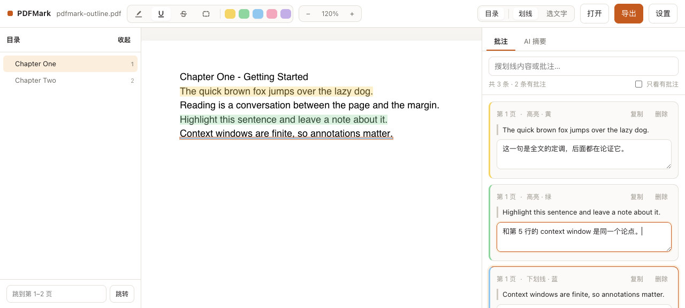
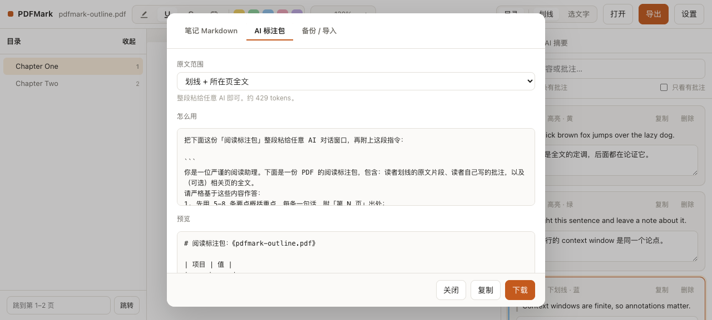

# PDFMark

[](./LICENSE)
[](https://react.dev)
[](https://www.typescriptlang.org/)
[](#privacy)

> Read a PDF in the browser, highlight and annotate as you go, then export the whole
> reading session as one Markdown package you can hand straight to an LLM.

[简体中文](./README.md) | **English**



Highlights and margin notes usually stay locked inside whichever reader you made them in.
Getting a summary out of them means scrolling back and copying quotes one at a time.
PDFMark collapses that into a single path — **read → highlight → annotate → export → summarize** —
and the file never leaves your machine.

- Pure frontend, no backend. `npm run dev` and you're running; the build is a static bundle
- PDFs and annotations live in browser IndexedDB, keyed by file fingerprint, restored on reload
- Two exports: a human-readable *Highlights & Notes*, and an *Annotation Package* built for an LLM
- Optionally plug in your own model endpoint and generate the summary inside the app

## Contents

- [Features](#features)
- [Getting started](#getting-started)
- [The full loop](#the-full-loop)
- [Export formats](#export-formats)
- [Model configuration (optional)](#model-configuration-optional)
- [How this compares](#how-this-compares)
- [Privacy](#privacy)
- [Stack](#stack)
- [Project layout](#project-layout)
- [Implementation notes](#implementation-notes)
- [Keyboard shortcuts](#keyboard-shortcuts)
- [Known limitations](#known-limitations)
- [Roadmap](#roadmap)
- [Contributing](#contributing)

## Features

**Reading**

| Feature | Notes |
| --- | --- |
| PDF rendering | pdf.js, page-by-page canvas, draws what you scroll to |
| Outline navigation | Reads the PDF's built-in bookmarks, collapsible tree, click to jump, current section follows the scroll; page-number jump works without bookmarks |
| Text selection | Switch to select mode and drag like a web page, then `Ctrl / Cmd + C` |
| Full-text search | `Ctrl / Cmd + F`, searches every page, matches are painted on the page, click a result to jump |
| Zoom | 50% – 300%, annotations stay anchored to the text |

**Annotating**

| Feature | Notes |
| --- | --- |
| Four mark types | Highlight / underline / strikeout / area box, each in 5 colours |
| Text-hugging highlights | Highlights follow the glyphs, not a single rectangle over the line |
| Quote capture | The text you covered is extracted and stored at draw time |
| Notes | Every mark takes a note; search them, filter by colour and by type, or show commented-only |
| Copy | One click on a mark card copies its quote (with the note, if any) |

**Exporting**

| Feature | Notes |
| --- | --- |
| Notes Markdown | Highlights and notes grouped by page, for humans; template is editable |
| Annotation package | Document info + quotes + your notes + (optional) source text, with a separate prompt template and an adjustable scope; template is editable |
| Chunked export | Long documents split by page range, each chunk self-contained, feed them to the model one at a time |
| Annotated PDF | Writes marks back as standard PDF annotations into a copy, so Acrobat / Preview / Chrome see and can edit them |
| Built-in summary | Bring your own base URL / key / model and stream a summary in-app; *Test connection* in settings tells you whether the config works before you start |
| Backup / import | Annotations as JSON, for moving between devices |

## Getting started

```bash
npm install
npm run dev        # dev server, http://localhost:5173
npm run build      # typecheck + build into dist/
npm run preview    # preview the production build
npm run typecheck  # types only
```

Requires Node.js 18 or newer.

`dist/` is a plain static directory — GitHub Pages, Vercel, Netlify or any object storage will serve it.
`base` is set to a relative path in `vite.config.ts`, so it also works from a subdirectory
(e.g. `user.github.io/pdfmark/`).

## The full loop

1. **Open** — drag a PDF into the window, or click *Open*. If the file has bookmarks, the outline opens on its own.
2. **Mark** — pick a tool and colour up top, then drag across the text. Double-click selects a single word.
3. **Annotate** — write notes for each mark in the right-hand panel. Clicking an entry jumps back to the text.
4. **Export** — *Export* in the top right, choose *Annotation package*, copy the whole thing.

For a few-hundred-page document, tick the chunked export option so one prompt never blows up the context window.



Three scopes, depending on how much material you want to send:

- **Quotes only** — fewest tokens, when the model already has the document
- **Quotes + source pages** — the default; enough context without blowing up the prompt
- **Quotes + full text** — for short documents, or when you want a whole-document judgement

The dialog estimates the token count as you switch, so you don't have to guess.

**Chunking**: pick *N pages per chunk* and the package is split by page range. Each chunk carries
only the annotations and source text inside its range, headed by "chunk k of m (pages a–b)".
Feed them to the model one at a time, then merge the summaries yourself.

**Annotated PDF**: exports a new file where the marks become standard PDF annotations —
highlight / underline / strikeout are written as text markup annotations (with `QuadPoints`,
hugging the glyphs), area boxes become square annotations, and your notes go into the annotation
content field. The original file is never touched; you always get a copy.

## Export formats

### Annotation package

The package itself is plain Markdown. The dialog separately offers a matching prompt template with
its own copy button — take the package alone and write your own prompt, or copy both. A real export:

````markdown
# Reading annotation package: some-paper.pdf

| Field | Value |
| --- | --- |
| File | some-paper.pdf |
| Pages | 2 |
| Annotations | 3 (2 with notes) |
| Exported | 2026-10-10 01:45 |
| Source scope | Full text of annotated pages |

## 1. My annotations and notes

### Page 1

> The quick brown fox jumps over the lazy dog.

- My note: this sentence sets the tone for the whole piece.

> Highlight this sentence and leave a note about it.

- My note: same argument as the context window line on page 1.

> Context windows are finite, so annotations matter.

- (underline, no note)

## 2. Appendix: source pages

### Page 1

Chapter One - Getting Started
...
````

The prompt template that ships alongside it (offered separately in the dialog, with a copy button):

```text
You are a rigorous reading assistant. Below is an annotation package for a PDF,
containing: passages the reader highlighted, notes the reader wrote, and
(optionally) the full text of the relevant pages.
Answer strictly from this material:
1. Summarize the key points in 5-8 bullets, one sentence each, citing "page N";
2. Then a section "What the reader cares about", drawn from their notes;
3. Three questions worth pursuing next;
4. If the material does not support a conclusion, say so instead of inventing it.
```

### Notes Markdown

The human-facing version, grouped by page:

```markdown
# Highlights and notes: some-paper.pdf

- 3 annotations, 2 with notes
- Exported: 2026-10-10 01:46
- Tool: PDFMark

## Page 1

> The quick brown fox jumps over the lazy dog.

**Note:** this sentence sets the tone for the whole piece.
```

Both can be copied or downloaded.

## Model configuration (optional)

Open *Settings* and fill in three fields:

- **Base URL** — anything that speaks `POST /chat/completions`, e.g. `https://api.openai.com/v1`,
  `https://api.deepseek.com/v1`, `https://open.bigmodel.cn/api/paas/v4`. Stopping at the version
  segment is enough; pasting the full endpoint from a provider's docs (`…/v1/chat/completions`)
  works too — the app will not append a second one.
- **API key**
- **Model name** — the exact ID from the provider. OpenRouter's free tier, for instance, is
  `nvidia/nemotron-3.5-lightning:free`.

The settings dialog has shortcuts for a few common providers (OpenAI / OpenRouter / DeepSeek /
Moonshot / Zhipu GLM / SiliconFlow).

**Hit *Test connection* before anything else.** It sends one short message and prints the outcome
right there: on success you get the round-trip time and what the model said; on failure you get the
step it died at (wrong URL, no network, CORS rejected, bad key, unknown model name). Far quicker
than marking a passage, pressing *Generate summary*, and watching a button that never changes.

> The key is stored only in your browser's `localStorage`. There are no hardcoded keys in the
> source, and none will ever be committed. Switching browsers or clearing site data means re-entering it.

Two timeouts guard the request: 30 seconds with no response headers, or 60 seconds between chunks,
both end the attempt with an error. The UI shows how long it has been waiting, so a slow model never
looks like a frozen page — which is exactly what used to happen, because a browser will happily wait
forever on a request that is never going to answer.

Configuring a model is optional — the annotation package can simply be pasted into any chat window.

## How this compares

PDF annotation is a solved problem in several places, and this project doesn't pretend to be
the only answer. Check which case you're in:

| If you… | You're probably better off with |
| --- | --- |
| Manage hundreds of papers, need citation formats and attachments | Zotero (with the Better Notes plugin for Markdown export) |
| Already write in Obsidian and want annotations in your vault | Obsidian plus a PDF annotator plugin |
| Read mostly EPUBs with some PDFs, want cross-device sync | Koodo Reader |
| Need several people discussing one document | Hypothesis |
| Just sign and mark up something occasionally | The built-in Firefox / Chrome PDF viewer |
| Want to dump a whole book at an AI, no close reading needed | NotebookLM (now Gemini Notebook) |

PDFMark aims at a different spot:

- **Nothing to install** — a web page; works on a phone too
- **Nothing uploaded** — no account, no server, your PDFs never enter anyone's database
- **Exports for the model, not just for you** — most tools export *notes you'll re-read later*;
  this one exports *something a model consumes*, which is why it has scope options, a token
  estimate and a prompt template attached

The trade-offs are real: no reference management, no cross-device sync, no collaboration.
If you need all three, use one of the tools above.

## Privacy

- The PDF and all annotations live in browser IndexedDB (database name `pdfmark`).
- The only network request happens when you click *Generate summary*; it goes to the endpoint
  **you** configured, and the payload is the annotation package.
- No account, no analytics, no telemetry, no third-party scripts.
- To wipe everything, clear site data in your browser (export a JSON backup first if you want it).

## Stack

| Dependency | Purpose | License |
| --- | --- | --- |
| React 18 | UI | MIT |
| TypeScript | Types | Apache-2.0 |
| Vite | Build | MIT |
| pdf.js (`pdfjs-dist`) | PDF rendering and text extraction | Apache-2.0 |
| pdf-lib | Writing annotations back into PDFs | MIT |
| marked | Markdown rendering for summaries | MIT |
| DOMPurify | Sanitizing before render | MPL-2.0 OR Apache-2.0 |

No UI kit, no state management library, no CSS framework — the styles are one hand-written
stylesheet and the store is 30 lines of `useSyncExternalStore`. The shorter the dependency
list, the more likely it still builds in a few years.

## Project layout

```text
src/
├── App.tsx                 Shell, file opening, drag & drop, shortcuts
├── components/
│   ├── PdfViewer.tsx       Page list, lazy rendering, current-page tracking
│   ├── PageView.tsx        Canvas paint + drag-to-mark + highlight overlay + text layer
│   ├── OutlinePanel.tsx    Bookmark tree and page jump
│   ├── NotePanel.tsx       Annotation list + colour/type filters
│   ├── SearchPanel.tsx     Full-text search results
│   ├── SummaryPanel.tsx    In-app streaming summary
│   ├── ExportDialog.tsx    Export / chunking / write-back to PDF / import
│   └── SettingsDialog.tsx  Model configuration + export template editing
├── lib/
│   ├── pdf.ts              pdf.js wrapper + text geometry (page-space normalisation)
│   ├── outline.ts          Bookmark tree and destination resolution
│   ├── geometry.ts         Rect hit-testing and merging
│   ├── search.ts           Cross-page search, hits mapped back to rects
│   ├── writeback.ts        Marks → standard PDF annotations
│   ├── templates.ts        Export templates and rendering
│   ├── db.ts               IndexedDB (docs / marks)
│   ├── export.ts           Markdown / annotation package / chunking / backup
│   ├── llm.ts              OpenAI-compatible streaming client
│   └── theme.ts            Colour table
├── store/app.ts            Minimal store and actions
└── types.ts                Data model
```

## Implementation notes

A few non-obvious decisions, worth a look before changing the code.

**Annotations are stored in page space, not screen pixels.** Each mark records rectangles in PDF
user space (points, origin top-left). Zooming, switching devices or re-rendering never shifts a mark.
Screen coordinates are only used transiently during interaction.

**Highlights hug the glyphs.** When you drag, the code first works out which text runs the selection
covers, then builds a rectangle per run from its real glyph metrics, merging runs that share a
baseline. The result is a text-hugging band rather than one oversized block over the line. The
covered text is extracted at the same moment and stored on the mark, so exports need no second pass.

**Marking and text selection are mutually exclusive modes.** They compete for the same mouse events:
in `annotate` mode an SVG overlay takes the drag, in `select` mode a transparent text layer does and
the browser handles the native selection. Hence two switchable buttons in the toolbar.

**The text layer is not pdf.js's `textLayer`.** It is built from the runs already extracted. PDF glyph
widths and browser font widths disagree: measuring a span's natural width gives a value wider than the
PDF's own, and placing spans naively makes the selection highlight drift further off the text as the
line gets longer. So every span is measured after render and squeezed back to the PDF width with `scaleX`.

**Outline destinations come in two shapes.** Named destinations (strings) need a `getDestination()`
lookup first; explicit arrays can start with either a page reference object or a literal page number.
Both are handled, and bookmarks whose destination cannot be resolved are still listed rather than dropped.

**A page's text has exactly one source.** `resolvePageText()` checks the in-memory cache, then
the PDF's embedded text layer. Search, export and quote capture all go through it, so text
extraction happens in one place instead of being scattered across the app.

**Writing back to PDF requires a coordinate flip.** PDFMark stores page space (origin top-left, y
down); the PDF annotation dictionary wants user space (origin bottom-left, y up). Every y goes
through `pageHeight - y`, and `QuadPoints` list each quad's four corners as top-left, top-right,
bottom-left, bottom-right. The output is always a copy — the original in IndexedDB is never modified.

**Search matching is forgiving.** Whitespace in the query matches "zero or more characters",
because PDF text is split into runs at arbitrary points and `the quick` can straddle a boundary
inside one run without a space. Hit ranges are mapped back to rectangles through a
character → run-index table, so they can be painted directly on the page.

## Keyboard shortcuts

| Key | Action |
| --- | --- |
| `Ctrl` / `Cmd` + `F` | Open the search panel |
| `Delete` / `Backspace` | Delete the selected mark |
| `Esc` | Clear search hits first, if any; otherwise clear the selection |
| `Ctrl` / `Cmd` + `C` | Copy the selection in select mode |

The delete key is ignored while focus is in an input, textarea or select, so it won't eat
your typing.

## Known limitations

- Marks over rotated or vertical text are approximate.
- A scanned PDF (pages that are just images) yields no quote text — you can still draw an area box.
- Annotation granularity is "rectangle + quoted text", not a precise character-level selection.
- Writing back to PDF currently **appends** annotations: it does not read or merge annotations that
  already exist in the original file. No appearance streams (`AP`) are generated — most viewers
  render default appearances, but a few old ones may only show an annotation icon.
- Large files (hundreds of pages) extract text page by page on first open; lazy rendering and a
  text cache help, but it is not instant.
- Annotations live in browser storage — clearing site data loses them; moving devices means manual JSON backup.

## Roadmap

Everything in the first list is done:

- [x] Write annotations back into the PDF file so Acrobat / Preview see them
- [x] In-document search
- [x] Filter the annotation list by colour / type
- [x] Customisable export templates
- [x] Chunked export for long documents

Next up, roughly in priority order; claims welcome:

- [ ] Generate appearance streams (`AP`) for written-back annotations, so viewers that don't render defaults show them correctly
- [ ] Read annotations already present in the original PDF and show them alongside your own
- [ ] Search options: whole-word match and case sensitivity
- [ ] One-click copy of a full page's text (handy when feeding long reads to an AI)

## Contributing

Issues and pull requests are welcome. For bug reports, the page count, whether the PDF is a scan,
and your browser version make a big difference in how fast it can be tracked down.

Before submitting: run `npm run typecheck` and `npm run build`, and make sure you are not committing
a `.env`, an API key, or a real PDF (`.gitignore` covers the usual cases).

## License

[MIT](./LICENSE)
